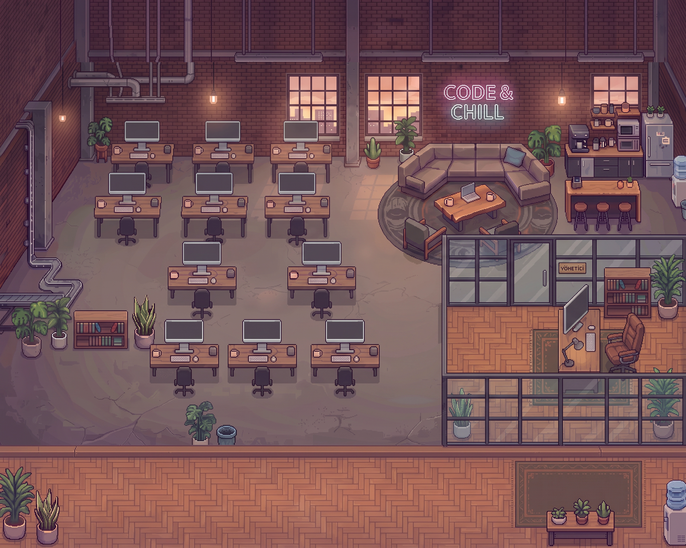

# Feyzullah Ofis

**Run a team of AI coding agents inside a living pixel-art office.**

[](https://github.com/Bluetwinklez/feyzullah-office/actions/workflows/app-test.yml)

Feyzullah Ofis is a Windows desktop app built with Electron. Give the team a task, watch specialists work, inspect their results, and bring changes into your project through a Git branch when worktree mode is available.

It brings Claude Code, Codex, and Antigravity CLI sessions into one workspace, with task planning, review, usage tracking, and a visual office that reflects agent activity.

> **Interface language:** Turkish. This guide uses English descriptions alongside the Turkish labels you will see in the app.
>
> **Project status:** Version 0.1.0, run from source. Native CLI discovery supports installation paths, PATH, and explicit executable overrides.



## Contents

- [What it does](#what-it-does)
- [Requirements](#requirements)
- [Installation](#installation)
- [Your first task](#your-first-task)
- [How the team works](#how-the-team-works)
- [Git workflow](#git-workflow)
- [Interface guide](#interface-guide)
- [Agents and providers](#agents-and-providers)
- [Usage limits and scheduling](#usage-limits-and-scheduling)
- [Settings](#settings)
- [Data, privacy, and permissions](#data-privacy-and-permissions)
- [Updating and backing up](#updating-and-backing-up)
- [Troubleshooting](#troubleshooting)
- [Development](#development)
- [Example project: GÖÇ](#example-project-göç)
- [License and credits](#license-and-credits)

## What it does

- **Coordinates specialists:** Prompt Master clarifies requests, a Manager assigns work, and Reality Checker reviews results.
- **Combines coding engines:** Claude handles planning and review by default; Codex and Antigravity handle much of the implementation.
- **Supports Git review:** Eligible tasks run in separate worktrees with branches you can inspect, merge, discard, or revert after merging.
- **Shows progress:** A live office, task board, Kanban view, reports, notifications, and agent details expose ongoing work.
- **Tracks availability:** Claude and Codex usage indicators, rate-limit fallback, and scheduled commands help manage work.
- **Adds conversational agents:** Cloud APIs and local OpenAI-compatible servers can provide chat-only agents.
- **Makes the workspace personal:** Saved commands, command history, office events, zoom controls, and a day/night cycle.

## Requirements

| Component | Purpose |
|---|---|
| Windows 10 or 11 | Target desktop platform |
| Node.js 20+ and npm | Install dependencies and launch Electron |
| Git | Clone the app and use task branches/worktrees |
| Claude Code, installed and signed in | Default engine for Manager and Prompt Master; an installed Codex fallback can also run these roles |
| Codex, installed and signed in | Recommended for implementation and Claude rate-limit fallback |
| Antigravity CLI executable named `agy.exe` | Optional engine, recommended for frontend specialists |
| Specialist catalogs | Recommended for a useful default team; downloaded separately below |

Use the official [Claude Code documentation](https://docs.claude.com/en/docs/claude-code) and [Codex repository](https://github.com/openai/codex) for their own setup and authentication.

**Account access and costs:** Sign in to each CLI before using it in Ofis. CLI access, subscriptions, quotas, and API billing are governed by the relevant provider. Adding an API key uses that provider's API billing; it does not automatically use a CLI subscription.

### CLI discovery in this version

Ofis checks explicit executable overrides first, known installation locations next, and native executables on PATH last. Known locations:

| Engine | Locations searched |
|---|---|
| Claude | `%APPDATA%\Claude\claude-code\` and matching Claude package directories under `%LOCALAPPDATA%\Packages\Claude_*\LocalCache\Roaming\Claude\claude-code\` |
| Codex | Version directories under `%LOCALAPPDATA%\OpenAI\Codex\bin\` |
| Antigravity | `%LOCALAPPDATA%\agy\bin\agy.exe` |

Claude and Codex discovery looks for their executable within version directories and one nested level. On Windows, PATH lookup accepts native `.exe` files, not npm `.cmd` shims. Set an explicit executable before starting Ofis when needed:

```powershell
$env:OFIS_CLAUDE_BIN = "C:\Tools\claude.exe"
$env:OFIS_CODEX_BIN = "C:\Tools\codex.exe"
$env:OFIS_AGY_BIN = "C:\Tools\agy.exe"
npm start
```

Set only the overrides for engines you have installed. Invalid overrides produce a startup error; remove or correct them before retrying.

The app expects the CLI flags and JSON events implemented in [src/agents/cli.js](src/agents/cli.js). See [compatibility and verification](docs/COMPATIBILITY.md) for automated coverage, live engine status, and the Windows acceptance procedure.

### Optional integrations

| Integration | Setup requirement |
|---|---|
| Godot 4 | For game tasks, discovery expects `C:\Tools\godot\godot.cmd`; exporting games also requires the appropriate Godot export templates |
| REA MCP | Configure separately for the reverse-engineering specialist |
| Feyzullah bridge | Optional integration for external CLI sessions and phone commands; the internal team can run without it |

Ofis does not install or authenticate these integrations for you. Follow the [REA setup guide](docs/INTEGRATIONS.md) for registration, authentication, diagnostics, and an initial verification task. REA has stricter Node.js requirements than the base app; check the guide before installing it.

## Installation

Run the following in PowerShell:

```powershell
git clone https://github.com/Bluetwinklez/feyzullah-office.git
cd feyzullah-office

npm ci

# Download specialist definitions before the first launch.
git clone --depth 1 https://github.com/msitarzewski/agency-agents.git catalog/agency-agents
git clone --depth 1 https://github.com/VoltAgent/awesome-claude-code-subagents.git catalog/voltagent

npm start
```

The catalogs are separate downloads, not npm dependencies. You can launch the app without them, but catalog-based hiring and default specialist availability will be limited.

After dependencies are installed, double-click **Feyzullah Ofis.vbs** to launch without a console window.

- **Show/hide:** `Ctrl+Alt+O`
- **Quit completely:** use the system tray menu.

### Preview without running real agents

```powershell
$env:OFIS_DEMO = "1"
npm start
Remove-Item Env:OFIS_DEMO
```

Demo mode is useful for exploring the interface before configuring CLI accounts. Remove the variable before starting a real session.

## Your first task

1. Start with a small project under your Windows user directory, such as `C:\Users\YourName\Projects\notes`.
2. For the branch workflow, use a Git repository with at least one commit. Commit the starting files you want the agents to see.
3. Open **Ajan ekle** (Add agent), check the team, and select engines that are installed on your computer.
4. Enter a request in the top command box:

   > In C:\Users\YourName\Projects\notes, add a searchable notes list, include tests, and explain how to run it.

5. Click **Gönder** (Send). Follow progress in **Görevler** (Tasks), the office, or **Genel bakış** (Overview).
6. Open **Görev panosu** (Task board). Confirm that the task has a branch, inspect **Farkı gör** (View diff), then choose **Dalı birleştir** (Merge branch) when ready.

The 👔 checkbox sends a request directly to the Manager, bypassing Prompt Master.

**Coordinator setup:** The app creates the Manager and Prompt Master with Claude. If Claude is missing, the runner can use an installed Codex fallback. Engine authentication errors still require a valid sign-in; an agy-only installation does not satisfy the default coordinator's fallback chain.

## How the team works

| Role | Responsibility | Default engine |
|---|---|---|
| Prompt Master | Turns a raw request into a clearer task | Claude |
| Manager | Plans work, hires specialists, and assigns tasks | Claude |
| Specialists | Implement, investigate, design, or test | Codex, agy, or Claude depending on role |
| Reality Checker | Reviews results and requests corrections | Claude |

The default workflow moves from clarification to planning, implementation, and review. Tasks targeting the same working directory run in sequence; tasks for different directories can run concurrently.

When Git worktrees are prepared, tasks from the same request in the same repository share a branch so later specialists can see earlier changes.

Review has a bounded correction loop. The app can hand later corrections to a Claude specialist when one is available and the usage guard permits it. Review can be skipped when the Claude usage guard is active, review is disabled, or no checker is available; a completed status alone does not prove that an independent review ran. Inspect the card's review information, actual diff, and test results.

### Timeouts and interrupted work

Manager-assigned tasks have a default 45-minute timeout, covering their execution and review cycle. The underlying agent runner also has a separate 60-minute limit per run; the task timeout can stop managed work earlier.

On restart, task cards that were active when Ofis closed are marked as failed with an application-closed error. Saved session references do not automatically resume those tasks. Inspect existing changes and use the task board to restart work. Pending scheduled commands are stored separately and remain queued.

## Git workflow

Separate task branches are enabled by default. The app attempts to create a worktree from the target repository's current `HEAD` and uses a branch named `ofis/<task-or-group-id>`.

**Worktree isolation is conditional:** it requires the branch setting to be enabled and a Git repository with an initial commit. When enabled for a Git repository, failed worktree preparation stops the task instead of editing the original directory. Non-Git folders and tasks with the branch setting disabled run directly in their assigned directory. Check the task card before relying on isolation.

Uncommitted changes in your original working directory are not part of the new worktree's starting snapshot.

| Action | Behavior |
|---|---|
| View diff | Saves pending worktree changes and shows the branch diff from its common ancestor |
| Merge branch | Commits pending work, merges into the project's currently checked-out branch, and cleans up the task worktree/branch after success |
| Discard branch | Removes the worktree and task branch; unmerged work can be lost |
| Revert merge | Creates a revert commit rather than rewriting history |

Merge checks reject tracked, uncommitted changes. If a merge conflicts, Ofis attempts to abort it and reports the conflict for manual resolution.

After a merge, automatic verification currently supports projects with a usable `package.json` test script. It runs `npm test` and may first install missing dependencies. Other test frameworks are not automatically detected by this path. A failing post-merge test is reported; it does not automatically undo the merge.

Old worktrees are eligible for cleanup after seven days, while active tasks are excluded. Cleanup removes a worktree only after saving succeeds and retains its branch. Failed saves leave pending files in place. Retained branches remain available for diff, merge, or discard after the worktree is removed. Keep normal project backups; cleanup is not a backup mechanism.

The **⟳** control and periodic Git synchronization reconcile supported changes made outside Ofis.

## Interface guide

| Area | What you can do |
|---|---|
| **Ekibim** — My team | Search agents, filter by state, and open agent details |
| **Ofis** — Office | Watch agent activity, select characters, pan, and zoom |
| **Genel bakış** — Overview | Check usage indicators, task counts, and recent activity |
| **Görevler** — Tasks | See work in progress, review, completed, and problem states |
| **Görev panosu** — Task board | Inspect reviews, cancel/restart tasks, and manage branches |
| **Raporlar** — Reports | Inspect task success, token usage, duration, and specialist statistics |
| **Ajan ekle** — Add agent | Hire catalog specialists or create custom agents |
| **Ayarlar** — Settings | Configure workflow, notifications, and office behavior |

Agent details show available task information, outputs, and actions. Permission requests associated with supported CLI/bridge sessions can be approved or rejected there.


### Keyboard shortcuts

| Shortcut | Action |
|---|---|
| `Ctrl+Alt+O` | Show/hide the window |
| `Ctrl+K` | Focus the command box |
| `Ctrl+F` | Search agents |
| `Alt+1` / `Alt+2` / `Alt+3` | Office / Tasks / Reports |
| `+` / `−` / `0` | Zoom in / zoom out / center |
| Mouse wheel | Zoom the office |
| `↑` / `↓` in the command box | Browse command history |
| `Esc` | Close the open dialog or panel |

## Agents and providers

### Hire a specialist

Open **Ajan ekle**, search by specialty or browse a division, choose an engine, and click **İşe al** (Hire).

Specialist definitions come from [Agency Agents](https://github.com/msitarzewski/agency-agents) and [VoltAgent](https://github.com/VoltAgent/awesome-claude-code-subagents).

| Specialty | Suggested engine |
|---|---|
| Architecture, planning, security, and review | Claude |
| Frontend and UI/UX implementation outside the design division | Antigravity |
| Visual design | Codex |
| Other implementation and testing | Codex |

You can change the suggested engine when hiring. Recommendations do not install the corresponding CLI or give it access to MCP services.

### Create a custom agent

Choose **API anahtarıyla özel ajan…** to configure a name, engine, role instructions, and, for API agents, a provider, model, endpoint, and key.

Provider presets include Anthropic, OpenAI, Gemini, OpenRouter, Groq, DeepSeek, Mistral, xAI, Together AI, Fireworks AI, Perplexity, Cerebras, DeepInfra, Ollama, LM Studio, and a custom OpenAI-compatible endpoint.

Use a model identifier supported by your provider and account. Preset suggestions are not a guarantee of model availability or endpoint compatibility.

**API agents are conversational:** they do not have a file-editing or shell tool loop. Use CLI agents for repository changes. Local Ollama and LM Studio servers can run without an API key when configured with a compatible endpoint.

## Usage limits and scheduling

| Engine | Usage source | Rate-limit fallback order |
|---|---|---|
| Claude | CLI rate-limit events; manual **↻ ölç** probe | Codex |
| Codex | Local Codex session records | Claude |
| Antigravity | No comparable usage meter | Codex, then Claude |

Fallback applies when the primary executable is missing or a recognized quota/rate-limit error occurs, and requires an available alternative executable and account. It does not fix authentication errors or arbitrary failures. Engines still marked rate-limited are not retried until their tracked reset time.

With the Claude usage guard enabled, the app avoids assigning Claude specialists when the reported usage reaches the guard threshold and bypasses Prompt Master. Usage displays depend on provider output and local records; they are not billing statements.

### Schedule a command

Write a command, click **⏰**, and choose a local time, **limitler açılınca** (when limits reopen), or both.

- When both are selected, the time must have arrived and the app's tracked limit conditions must be clear.
- A time that has already passed is scheduled for the next day.
- Pending commands persist across restarts; commands rejected at dispatch remain queued.
- **Ofis must be running to dispatch commands.** This is an in-app queue, not a Windows background scheduler.
- Availability is based on the limits Ofis knows about; it cannot guarantee provider acceptance.

Use **⭐** to save frequently used commands.

## Settings

Open **⚙️ Ayarlar**. The following workflow options are enabled by default:

| Setting | Effect |
|---|---|
| Prompt Master | Clarifies requests before the Manager receives them |
| Reality Checker | Reviews specialist results |
| Limit guard | Reduces Claude assignments near the reported usage limit |
| Git branch per task | Attempts separate worktrees for eligible repositories |
| Codex network access | Enables network access within Codex's workspace-write configuration |
| Caveman style | Adds concise response instructions for Codex/agy |
| Notifications and speech | Announces supported task and permission events |
| Office events | Enables ambient office activity |
| Daily report | Produces a daily summary; default time is 21:00 |

## Data, privacy, and permissions

### Local storage

The default data directory is `%USERPROFILE%\.feyzullah\`. Set `FEYZULLAH_HOME` before launch to use another location.

| File or folder | Contents |
|---|---|
| `ofis.json` | Settings and saved commands |
| `ofis-agents.json` | Agent definitions and encrypted API keys |
| `ofis-board.json` | Task board |
| `ofis-history.json` | Completed-task history |
| `ofis-usage.json` | Cached usage information |
| `ofis-schedule.json` | Pending commands |
| `ofis-runtime.json` | Agent session references and conversation state |
| `ofis-work\` | Agent directories and Git worktrees |

CLI tools also maintain their own authentication and session data outside this directory.

### What is sent over the network?

Local storage does not mean offline processing. Cloud CLI and API agents send requests to their configured providers; those requests may include prompts, conversation context, and project content made available to the agent. MCP tools and network-enabled commands can contact additional services.

API keys are encrypted at rest through Electron `safeStorage` using Windows DPAPI. The agent store exposes key presence and a short hint to the UI rather than returning the stored key. Keys are decrypted in the main process and transmitted to the configured API endpoint for authentication.

Use trusted API endpoints. Data retention, billing, and processing are governed by the services you choose. Local model endpoints can keep their own inference local, but do not make the rest of the team offline.

### Execution permissions

- Claude runs with `acceptEdits` and predefined tool permissions; the launcher does not use `--dangerously-skip-permissions`.
- Codex is launched with `workspace-write`; network access is configurable and enabled by default in Ofis.
- Antigravity is launched with `--sandbox`.
- Actual enforcement depends on the installed CLI and its configuration. Allowed commands include development tools that execute code; a worktree is not a security sandbox.
- Automatic task-directory creation is restricted to paths under the user's home directory.

Review the selected engine, task directory, and diff before merging generated work.

## Updating and backing up

### Update the source checkout

Quit Ofis completely from the tray, preserve any local source changes, and run:

```powershell
git pull --ff-only
npm ci
npm start
```

Catalog clones are independent. Update each from its own directory if needed; upstream catalog changes can affect available specialists.

### Back up and restore

1. Finish active tasks and quit the app.
2. Back up the data directory and your project repositories.
3. Preserve pending task branches and their associated repositories; worktrees contain Git links and are not independent project copies.
4. Restore data with Ofis closed, then reopen and check the task board.

Encrypted API keys are tied to Windows protection context. Do not assume copied keys will decrypt on another computer or user account; re-enter them if needed. A data-directory backup does not include CLI credentials stored elsewhere.

To reset state, move the data directory to a backup location while Ofis is closed. Keep it until you have recovered any work you need.

## Troubleshooting

| Symptom | What to check |
|---|---|
| CLI works in a terminal but Ofis cannot find it | Compare its executable location with [CLI discovery](#cli-discovery-in-this-version); check native `.exe` availability or set an executable override |
| First request fails with a missing Claude CLI | Configure a discoverable Claude executable or its Codex fallback, and sign in |
| Catalog or specialist list is empty | Check that the catalog clones exist at the installation paths above; use **Ajan ekle** to hire specialists |
| **Köprü yok** — no bridge | The optional external-session bridge is offline; the internal agent team does not require it |
| Claude usage says **ölçülmedi** — not measured | Click **↻ ölç**, which makes a small request, or wait for a Claude session to report usage |
| Task appears stuck | Inspect its output, then cancel/restart from the task board; managed tasks default to 45 minutes, with a separate 60-minute agent-run limit |
| Agent is waiting for permission | Select the agent and inspect the available **İzin ver / Reddet** actions; some actions require the external bridge |
| Task failed after restarting Ofis | Active tasks are marked failed on startup; inspect existing work, then restart from the task board |
| Task completed without a review | Check whether review was disabled, the Claude usage guard was active, or a checker was unavailable |
| No Git branch on the card | Check the branch setting, repository HEAD, and worktree preparation; the task may be running in its assigned directory |
| Merge fails | Commit tracked local changes first; resolve branch conflicts manually and synchronize the board |
| Post-merge tests did not run | Automatic detection currently requires a usable npm test script |
| Scheduled task did not start | Keep Ofis running and check local time and tracked limit conditions |
| REA tools are unavailable | Configure and authorize the MCP integration in the relevant CLI separately |
| Characters look simpler than the screenshots | The optional MetroCity pack is not distributed; the app can draw fallback characters |
| Office is too small or large | Use zoom controls, drag to pan, and press `0` to center |

If you own the appropriate MetroCity asset license, place `Suit.png`, `Suit1.png`, and `Hair.png` under `assets/packs/metrocity/`.

When [reporting a bug](https://github.com/Bluetwinklez/feyzullah-office/issues), include the app commit, Windows/Node/CLI versions, steps to reproduce, and relevant errors. Redact credentials and private project content.

## Development

```powershell
npm ci
npm test
npm start
```

Tests run through Node's built-in test runner. They are separate from the tests Ofis may run inside a user's project.

For a demo screenshot, create the output directory first:

```powershell
New-Item -ItemType Directory -Force C:\temp | Out-Null
$env:OFIS_DEMO = "1"
$env:OFIS_SNAPSHOT = "C:\temp\ofis.png"
npm start
Remove-Item Env:OFIS_DEMO
Remove-Item Env:OFIS_SNAPSHOT
```

Snapshot mode captures the window after a short delay and exits.

Demo mode populates the interface with sample data, disables the external bridge connection, and rejects task dispatch. It still initializes local app state; use a separate data directory for a clean preview. Rejected scheduled commands remain queued for a later real session.

| Path | Responsibility |
|---|---|
| `main.js` | Electron lifecycle, IPC, integration, and orchestration |
| `preload.cjs` | Renderer-to-main bridge |
| `src/agents/` | CLI/API execution, providers, catalog loading, and coordination |
| `src/gitwork.js` | Worktrees, branch actions, and post-merge npm tests |
| `src/` | Office state, usage tracking, scheduling, and notifications |
| `renderer/` | Interface and office rendering |
| `assets/` | Visual assets |
| `test/` | Application tests |
| `tools/` | Asset utilities |
| `ornekler/goc/` | Example Godot project |

The current npm scripts cover starting and testing the app. An installer/build packaging workflow is not defined in `package.json`.

### Contributing

Open an issue to discuss substantial changes, then submit a focused pull request with a description of the resulting behavior and relevant verification. Run `npm test` for code changes and include screenshots for interface changes. Mention the Windows and CLI versions used when changing engine integrations. Do not include API keys, account credentials, or private session data.

The [Application tests workflow](.github/workflows/app-test.yml) runs the app suite on Windows and Ubuntu with Node 22 and 24 for pushes and pull requests, and supports manual runs. It uses fake CLI processes and local provider fixtures, so no account credentials are required. Check [Actions](https://github.com/Bluetwinklez/feyzullah-office/actions/workflows/app-test.yml) for actual results. The GÖÇ example has a separate workflow. Live engine and GUI checks are documented in the [compatibility guide](docs/COMPATIBILITY.md).

## Example project: GÖÇ

[GÖÇ](ornekler/goc) is a Godot 4 Windows action/exploration RPG prototype included as an example of work produced through the office.

Explore its [README](ornekler/goc/README.md), [design document](ornekler/goc/docs/TASARIM.md), and [asset provenance](ornekler/goc/docs/VARLIKLAR.md). The repository includes a dedicated [GÖÇ test workflow](.github/workflows/goc-test.yml).

## License and credits

Application code is released under the [MIT License](LICENSE).

- Specialist catalogs are downloaded separately from [Agency Agents](https://github.com/msitarzewski/agency-agents) and [VoltAgent](https://github.com/VoltAgent/awesome-claude-code-subagents); consult their licenses.
- MetroCity assets are optional and subject to their own license.
- Claude, Codex, Antigravity, and other services retain their respective terms and trademarks.

### Shared repository task scheduling

Tasks targeting the same Git repository, including different subdirectories, run in plan order because they share one task-group worktree. Tasks targeting separate repositories may run in parallel. This prevents specialists from overwriting each other's files or committing another task's unfinished changes.
