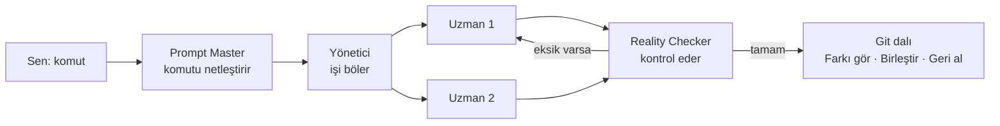

# Feyzullah Ofis

**Yapay zekâ ajanlarından oluşan bir ekibi, piksel bir ofiste yöneten Windows uygulaması.**

Tek bir komut yazarsın; ekip işi bölüşür, yapar, birbirini kontrol eder ve sonucu sana ayrı bir git dalı olarak teslim eder. Bu sırada ajanları ofiste masalarında çalışırken, mola verirken ya da senden izin beklerken görürsün.


> **English:** A Windows desktop app (Electron) that runs Claude Code, Codex and Antigravity CLIs as a team in a pixel-art office. Type one task; it is clarified, split among specialist agents, reviewed, and delivered as a git branch you can diff, merge or revert. UI is in Turkish.

---

## İçindekiler

1. [Nasıl çalışır?](#nasıl-çalışır)
2. [Kurulum (5 dakika)](#kurulum-5-dakika)
3. [İlk görevini ver](#i̇lk-görevini-ver)
4. [Ekran rehberi](#ekran-rehberi)
5. [Özellikler](#özellikler)
6. [Ayarlar](#ayarlar)
7. [Örnek proje: GÖÇ](#örnek-proje-göç)
8. [Güvenlik ve gizlilik](#güvenlik-ve-gizlilik)
9. [Sık sorulanlar](#sık-sorulanlar)
10. [Geliştirme](#geliştirme)

---

## Nasıl çalışır?



| Rol | Ne yapar | Varsayılan motor |
|---|---|---|
| **Prompt Master** | Yazdığın ham komutu net bir göreve çevirir | Claude |
| **Yönetici** | Görevi parçalara böler, doğru uzmanlara dağıtır | Claude |
| **Uzmanlar** | Kodu yazar, tasarımı yapar, testleri çalıştırır | Çoğu Codex; arayüz işleri agy |
| **Reality Checker** | İşi kontrol eder; eksikse en çok 2 kez geri gönderir | Claude |

Kural basit: **planlama ve kontrol Claude'da, iş yükü Codex ve agy'de.** Bir motorun kullanım limiti dolarsa görev kendiliğinden diğer motorla devam eder.

---

## Kurulum (5 dakika)

### Gerekenler

| Gereken | Neden | Zorunlu mu |
|---|---|---|
| Windows 10 / 11 | Uygulama Windows içindir | Evet |
| [Node.js 20+](https://nodejs.org) | Uygulamayı çalıştırmak için | Evet |
| [Git](https://git-scm.com) | Her görev ayrı bir dalda yapılır | Evet |
| En az bir CLI: [Claude Code](https://docs.claude.com/en/docs/claude-code), [Codex CLI](https://github.com/openai/codex) ya da Antigravity `agy` | Ajanların işi bu araçlarla yapılır | Evet (en az biri) |
| Godot 4 (`C:\Tools\godot\godot.cmd`) | Oyun geliştirme görevleri için | Hayır |

> Her CLI'da kendi hesabınla **önceden oturum açmış** olmalısın. Ofis senin adına şifre ya da anahtar girmez.

### Adımlar

```powershell
# 1. İndir
git clone https://github.com/Bluetwinklez/feyzullah-office.git
cd feyzullah-office

# 2. Bağımlılıkları kur
npm install

# 3. Uzman kataloglarını indir (isteğe bağlı ama önerilir)
git clone --depth 1 https://github.com/msitarzewski/agency-agents.git catalog/agency-agents
git clone --depth 1 https://github.com/VoltAgent/awesome-claude-code-subagents.git catalog/voltagent

# 4. Başlat
npm start
```

Konsol penceresi istemiyorsan `Feyzullah Ofis.vbs` dosyasına çift tıkla.

**Kısayol:** `Ctrl+Alt+O` pencereyi gösterir/gizler. Uygulamadan tamamen çıkmak için sistem tepsisindeki simgeyi kullan.

---

## İlk görevini ver

1. Üstteki kutuya ne istediğini yaz. Örnek:
   ```
   C:\Projeler\notlar klasöründe basit bir not alma web uygulaması yap, testlerini de yaz
   ```
2. **Gönder**'e bas. Prompt Master komutu netleştirir, Yönetici görevleri dağıtır.
3. Ofiste ajanların masalarına oturduğunu görürsün. Sağdaki **Genel bakış** ve üstteki **Görevler** sekmesi ilerlemeyi gösterir.
4. İş bitince **Görev panosu**nda (sol menüde ✓ simgesi):
   - **Farkı gör** — ne değiştiğini incele
   - **Dalı birleştir** — kendi projene al (sonrasında testler otomatik çalışır)
   - **Dalı at** ya da birleştirdiysen **Geri al**

> İpucu: Kutudaki 👔 kutucuğunu işaretlersen komut Prompt Master'ı atlayıp doğrudan Yöneticiye gider.

---

## Ekran rehberi

| Bölge | Ne var |
|---|---|
| **Sol menü** | Ofis · Görev panosu · Uzman istatistikleri · Ajan ekle · Zamanlanmış komutlar · Ayarlar |
| **Üst çubuk** | Ofis / Görevler / Raporlar sekmeleri, komut kutusu, ⭐ kayıtlı komutlar, ⏰ zamanla, bağlantı, 🔔 bildirimler, saat |
| **Ekibim (sol)** | Tüm ajanlar; arama ve Tümü / Çalışan / Molada süzgeci. Bir ajana tıkla → ayrıntısı sağda açılır |
| **Ofis (orta)** | Canlı ofis. Ajana tıkla → ne yaptığını gör. Duvardaki panoya tıkla → görev panosu |
| **Genel bakış (sağ)** | Claude ve Codex kullanım limitleri, aktif/biten görevler, son aktiviteler |
| **Alt çubuk** | Sistem durumu, limiti dolan motorlar, ajan sayısı |

**Ajan ayrıntısında** görev, çalıştırdığı komutlar ve çıktıları, değiştirdiği dosyaların farkı, izin istekleri (**İzin ver / Reddet**) ve ajana mesaj yazma kutusu bulunur.

### Klavye kısayolları

| Tuş | İş |
|---|---|
| `Ctrl+K` | Komut kutusuna git |
| `Ctrl+F` | Ajan ara |
| `Alt+1` / `Alt+2` / `Alt+3` | Ofis / Görevler / Raporlar |
| `+` / `−` / `0` | Ofisi yakınlaştır / uzaklaştır / ortala (fare tekerleği de olur) |
| `↑` / `↓` (komut kutusunda) | Önceki komutlar |
| `Esc` | Açık kutuyu ya da paneli kapat |

---

## Özellikler

**Ekip ve iş akışı**
- Prompt Master → Yönetici → Uzmanlar → Reality Checker zinciri
- Aynı klasördeki görevler sırayla, farklı klasördekiler paralel çalışır
- Her komut kendi git dalında (`ofis/...`); birleştirme sonrası proje testleri
- Limit dolunca yedek motora geçiş (Codex ↔ Claude, agy → Codex → Claude)

**Uzmanlar**
- [Agency Agents](https://github.com/msitarzewski/agency-agents) ve [VoltAgent](https://github.com/VoltAgent/awesome-claude-code-subagents) kataloglarından yüzlerce uzman (ikisi de MIT) — **Ajan ekle** → ara → **İşe al**
- Ters Mühendis uzmanı (REA MCP ile)
- API anahtarıyla kendi ajanını ekle: Anthropic, OpenAI, Gemini, OpenRouter, Groq, DeepSeek, Mistral, xAI, Together, Fireworks, Perplexity, Cerebras, DeepInfra, Ollama, LM Studio ya da herhangi bir OpenAI uyumlu adres

**Takip**
- Claude ve Codex 5 saatlik / haftalık kullanım göstergesi, limit koruması
- Görevler (kanban) ve Raporlar (başarı oranı, token, ortalama süre, uzman başarıları)
- Bildirimler, sesli okuma, akşam günlük rapor

**Kolaylıklar**
- ⏰ **Zamanlanmış komut:** belli bir saatte ya da "limitler açılınca" kendiliğinden gönder
- ⭐ Kayıtlı komutlar, komut geçmişi
- Ofis dışında birleştirdiğin dallar panoda doğru görünür (git ile eşitleme)
- Gerçek güneşe göre gece/gündüz, ofis olayları (pizza, kedi…)

---

## Ayarlar

Sol alttaki ⚙️ ile açılır. Hepsi açık/kapalı anahtarıdır:

| Ayar | Ne yapar | Varsayılan |
|---|---|---|
| Prompt Master | Komutu önce netleştirir | Açık |
| Reality Checker | Uzman işini kontrol eder | Açık |
| Limit koruması | Claude %90'ı geçince Claude'a iş verilmez | Açık |
| Görev başına git dalı | Git deposundaki işler ayrı dalda yapılır | Açık |
| Codex ağ erişimi | Codex `npm install` gibi işler için internete çıkabilir | Açık |
| caveman üslubu | Codex/agy cevapları kısa olur | Açık |
| Bildirim · Sesli okuma | Görev bitince / izin istenince | Açık |
| Ofis olayları | Pizza, kedi, elektrik dalgalanması | Açık |
| Günlük rapor | Seçtiğin saatte özet (varsayılan 21:00) | Açık |

Ayarlar ve tüm veriler `%USERPROFILE%\.feyzullah\` klasöründe durur (`FEYZULLAH_HOME` ortam değişkeniyle değiştirilebilir).

---

## Örnek proje: GÖÇ

[`ornekler/goc`](ornekler/goc) klasöründe, bu ofisin baştan sona yaptığı bir oyun var: **GÖÇ**, Godot 4 ile yapılmış Windows aksiyon-keşif RPG prototipi.

- 4 aşamada, yalnızca Ofis'e verilen komutlarla yapıldı
- 3B modeller, görseller ve sesler [Krea AI](https://www.krea.ai) ile üretildi
- 60 otomatik test; GitHub Actions'ta **GÖÇ testleri** iş akışı çalıştırır
- Ayrıntılar: [GÖÇ README](ornekler/goc/README.md) · [tasarım belgesi](ornekler/goc/docs/TASARIM.md)

---

## Güvenlik ve gizlilik

- **Anahtarlar bilgisayarından çıkmaz.** API anahtarları Windows şifrelemesiyle (DPAPI) `%USERPROFILE%\.feyzullah\` altında saklanır; pencereye, günlüklere ya da bu repoya yazılmaz.
- **Tam yetki verilmez.** `--dangerously-skip-permissions` kullanılmaz; her uzmanın kullanabileceği araçlar tek tek tanımlıdır.
- **Kum havuzu:** Codex yalnız çalışma klasörüne yazabilir; agy `--sandbox` ile çalışır.
- **Senin kodun korunur:** Uzmanlar ayrı bir git çalışma kopyasında çalışır; projene yalnız sen **Birleştir** dediğinde girer.
- Yeni görev klasörleri yalnız kullanıcı klasörünün altında açılabilir.

---

## Sık sorulanlar

**Ofiste hiç ajan görünmüyor.**
Ajan eklemen gerekir: sol menüde **Ajan ekle**. İlk açılışta çekirdek ekip otomatik gelir; katalogları indirmediysen (Kurulum 3. adım) uzman listesi boş olabilir.

**"Köprü yok" yazıyor.**
Sorun değil. Köprü, bilgisayardaki *diğer* CLI oturumlarını ofiste göstermek ve telefondan komut almak içindir. Ofis'in kendi ekibi köprü olmadan da çalışır.

**Claude limiti "ölçülmedi" görünüyor.**
Kartın altındaki **↻ ölç** düğmesine bas (çok küçük bir istek gönderir) ya da bir Claude uzmanı çalışınca kendiliğinden dolar.

**Karakterler kare kafalı / sade görünüyor.**
Karakter paketi (MetroCity) lisansı nedeniyle repoda yok, karakterler kodla çizilir. Paketi edinirsen `Suit.png`, `Suit1.png`, `Hair.png` dosyalarını `assets/packs/metrocity/` klasörüne koy.

**Bir görev takıldı.**
Görev panosunda **İptal**, sonra **↻ Yeniden başlat**. Her görevin 60 dakikalık süre sınırı vardır.

---

## Geliştirme

```powershell
npm test                                          # tüm testler (node --test)
$env:OFIS_DEMO=1; npm start                       # gerçek ajanlar yerine demo verisi
$env:OFIS_SNAPSHOT="C:\temp\ofis.png"; npm start  # birkaç saniye sonra ekran görüntüsü alıp kapanır
```

| Klasör | İçerik |
|---|---|
| `main.js` | Ana süreç: pencere, ajan çalıştırıcı, yönetici, git, bildirimler |
| `src/agents/` | Ajan motorları (CLI ve API), yönetici, katalog, sağlayıcılar |
| `src/` | Ofis modeli, kullanım takibi, git işlemleri, zamanlama, istatistikler |
| `renderer/` | Arayüz ve ofis çizimi |
| `assets/` | Ofis görseli ve karakterler (Krea AI ile üretildi) |
| `ornekler/goc/` | Örnek proje |

---

## Lisans

Kod [MIT](LICENSE) lisanslıdır. Uzman katalogları ayrıca, kendi (MIT) lisanslarıyla indirilir. GÖÇ'teki varlıkların kaynağı [VARLIKLAR.md](ornekler/goc/docs/VARLIKLAR.md) dosyasında yazar.
