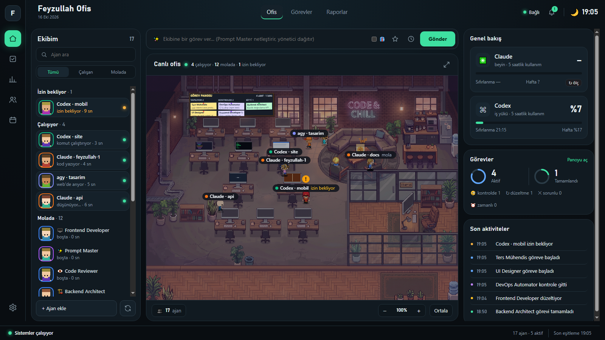

# Feyzullah Ofis

Yapay zekâ ajanlarının piksel bir ofiste çalıştığı Windows masaüstü uygulaması. Claude Code, Codex ve Antigravity (agy) CLI'larını bir **ekip** gibi yönetir: komutu yazarsın, Prompt Master netleştirir, Yönetici işi uzmanlara dağıtır, Reality Checker kontrol eder, sonuç git dalı olarak önüne gelir.



> **English summary:** Feyzullah Ofis is an Electron desktop app (Windows) that turns Claude Code, Codex and Antigravity CLIs into a team working in a pixel-art office. You type one command; a Prompt Master rewrites it, an Admin agent splits it into tasks for specialist agents (from the MIT-licensed Agency Agents and VoltAgent catalogs), a Reality Checker reviews each result, and every task lands on its own git worktree branch that you can diff, merge or revert from the task board. Usage limits are tracked and tasks fall back to another engine when one hits its limit. UI is in Turkish.

## Özellikler

- **Ofis:** ajanlar masalarında çalışır, izin bekleyen ayağa kalkar, işi biten mola köşesine/mutfağa gider; gece-gündüz gerçek güneşe göre değişir; duvarda yapışkan notlu görev panosu.
- **Komut hattı:** Prompt Master → Yönetici (plan) → uzmanlar → Reality Checker (en çok 2 düzeltme turu) → rapor. Aynı klasördeki görevler sırayla çalışır.
- **İş bölümü:** planlama, mimari ve inceleme Claude'da; uygulama yükü Codex ve agy'de. Bir motorun kullanım limiti dolarsa görev otomatik olarak yedek motorla sürer.
- **Git:** her komut grubu ayrı bir git worktree dalında çalışır; panodan **Farkı gör / Birleştir / Geri al**, birleştirme sonrası proje testleri.
- **Uzman kataloğu:** [Agency Agents](https://github.com/msitarzewski/agency-agents) ve [VoltAgent awesome-claude-code-subagents](https://github.com/VoltAgent/awesome-claude-code-subagents) (ikisi de MIT) uzmanları işe alınabilir; Ters Mühendis (REA MCP) uzmanı dahili.
- **Limitler:** Claude ve Codex 5 saatlik/haftalık kullanım göstergesi, limit koruması.
- **API ajanları:** 16 hazır sağlayıcı (Anthropic, OpenAI, Gemini, OpenRouter, Groq, DeepSeek, Mistral, Ollama, LM Studio …). Anahtarlar Windows DPAPI (`safeStorage`) ile şifreli saklanır, pencereye gönderilmez.
- **Arayüz:** Ofis / Görevler (kanban) / Raporlar sekmeleri; ekipte arama ve Çalışan/Molada süzgeci; ofiste yakınlaştırma, sürükleyerek gezinme ve tam ekran; son aktiviteler ve bildirim zili; alt durum çubuğu.
- **Zamanlanmış komutlar:** bir komutu belli saatte ve/veya kullanım limitleri açılınca yöneticiye otomatik gönder.
- **Pano ↔ git eşitleme:** Ofis dışında birleştirilen ya da silinen dallar panoda doğru görünür.
- **Kısayollar:** Ctrl+K komut kutusu, Ctrl+F ajan ara, Alt+1/2/3 sekmeler, +/−/0 yakınlaştırma, Esc kapat, ↑/↓ komut geçmişi.
- **Bildirim ve ses**, günlük rapor, kayıtlı komutlar, uzman istatistikleri.
- **Oyun geliştirme:** Godot kuruluysa oyun uzmanları başsız test ve Windows dışa aktarma yapabilir.

## Gereksinimler

- Windows 10/11 (Windows Server 2022'de de denendi)
- Node.js 20+ ve npm
- En az bir CLI: [Claude Code](https://docs.claude.com/en/docs/claude-code), [Codex CLI](https://github.com/openai/codex) ya da Antigravity `agy` — her biri kendi hesabıyla oturum açmış olmalı
- Git (görev dalları için)
- İsteğe bağlı: Godot 4.x (`C:\Tools\godot\godot.cmd` olarak), [Feyzullah](#feyzullah-köprüsü) köprüsü

## Kurulum

```powershell
git clone https://github.com/Bluetwinklez/feyzullah-office.git
cd feyzullah-office
npm install
# uzman katalogları (repoya dahil değil):
git clone --depth 1 https://github.com/msitarzewski/agency-agents.git catalog/agency-agents
git clone --depth 1 https://github.com/VoltAgent/awesome-claude-code-subagents.git catalog/voltagent
npm start
```

Konsolsuz başlatmak için `Feyzullah Ofis.vbs`. Kısayol **Ctrl+Alt+O** pencereyi gösterir/gizler; çıkış tepsi simgesinden.

## Ayarlar

Uygulama içi ⚙️ panelinden ya da `~/.feyzullah/ofis.json` dosyasından:

| Anahtar | Varsayılan | Açıklama |
|---|---|---|
| `promptMaster`, `review`, `limitGuard`, `gitBranches` | açık | komut hattı adımları |
| `codexNetwork` | açık | Codex kum havuzunda ağ erişimi (npm install vb.) |
| `caveman` | açık | Codex/agy uzmanlarına kısa yanıt üslubu ([caveman](https://github.com/JuliusBrussee/caveman) kuruluysa) |
| `notify`, `speak`, `events`, `dailyReport` | açık | bildirim, ses, ofis olayları, günlük rapor |
| `reportHour` | 21 | günlük rapor saati |
| `lat`, `lon` | 41.01, 28.98 | gün doğumu/batımı |
| `hotkey` | `Control+Alt+O` | |
| `feyzullahRoot` | `..\feyzullah-1` | Feyzullah köprüsü klasörü (isteğe bağlı) |

Veriler `~/.feyzullah/` altındadır (`FEYZULLAH_HOME` ile değiştirilebilir): pano, geçmiş, kullanım, şifreli API ajanları, görev çalışma kopyaları.

## Feyzullah köprüsü

Ofis, bilgisayardaki CLI oturumlarını izlemek ve telefondan komut almak için Feyzullah köprüsünü (127.0.0.1:5185) kullanabilir. Köprü yoksa Ofis yine çalışır: kendi ajanlarını CLI'larla doğrudan yürütür, yalnız dışarıdaki oturumlar ofiste görünmez.

## Güvenlik

- `--dangerously-skip-permissions` kullanılmaz; her uzmanın izinli araçları ayrı ayrı tanımlıdır (`src/agents/runner.js`).
- Codex `workspace-write` kum havuzunda, agy `--sandbox` ile çalışır.
- Yeni görev klasörleri yalnız kullanıcı klasörü altında açılır.
- API anahtarları düz metin olarak hiçbir dosyaya ya da günlüğe yazılmaz.

## Deneme ve test

```powershell
npm test                                         # node --test
$env:OFIS_DEMO=1; npm start                      # köprü yerine demo verisi
$env:OFIS_SNAPSHOT="C:\temp\ofis.png"; npm start # birkaç saniye sonra ekran görüntüsü alıp çıkar
```

## Görseller

- Ofis arka planı ve karakter görselleri [Krea AI](https://www.krea.ai) ile üretildi.
- MetroCity karakter paketi (JIK-A-4) lisansı gereği repoda **yok**; isteğe bağlı olarak `assets/packs/metrocity/` altına `Suit.png`, `Suit1.png`, `Hair.png` konabilir. Paket yoksa karakterler kodla çizilir.

## Lisans

Kod [MIT](LICENSE). Dahil edilen uzman katalogları kendi lisanslarıyla (MIT) ayrıca indirilir.
