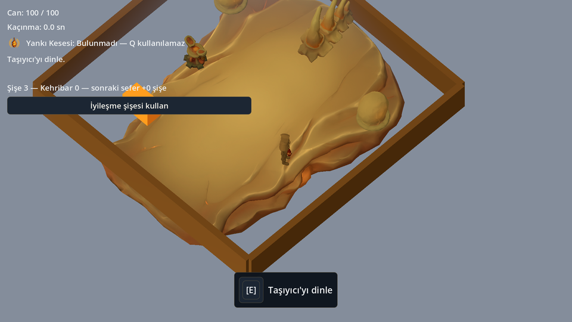
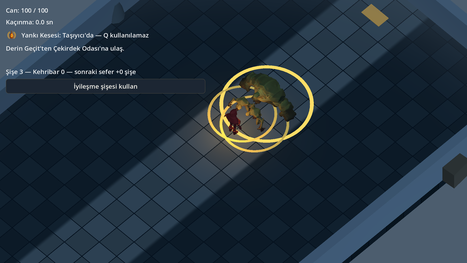
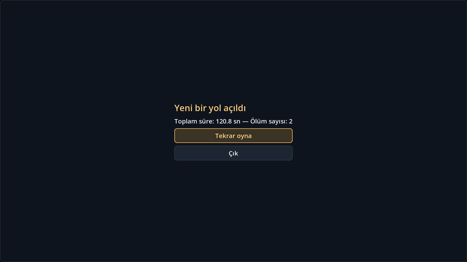

# GÖÇ

> Sisin içinde avlan, bulduğun organları kendi bedenine tak, sonra onları sırtında yaşadığın dev canlıya bağışla.

Windows için tek oyunculu, üstten çapraz kameralı 3B aksiyon-keşif RPG **prototipi**. Godot 4.7.2 ile yapıldı.

## Oyun

Sis dünyayı kaplamış; insanlar "Taşıyıcı" denen dev gezgin canlıların sırtında yaşıyor ve sizin Taşıyıcınız yaralı. Terk edilmiş Durgun Tesis'e inip Avcı, Ağır ve Püskürtücü ile savaşıyor, iki organ buluyorsunuz: Yankı Kesesi ve Soluk Çekirdeği. Her organ ya sizde bir yetenek olur (tarama darbesi, sis kalkanı) ya da Bağ Düzeneği'nde Taşıyıcı'ya bağlanıp yeni yollar açar. Karar geri alınabilir, ama bir organ aynı anda yalnız bir yerde durur. Asıl soru şu: bulduğunuz gücü kendinizde mi tutacaksınız, yaşadığınız canlıya mı vereceksiniz? Hedef süre 15–20 dakika; bu bir test hedefidir, garanti değildir. Bu prototip, organ ikilemini gerçek oyuncularla sınamak için yapıldı. İkilem sınanacak bir tasarım hipotezidir; özgün ya da kanıtlanmış bir fikir olarak sunulmaz.

Tasarımın tamamı: [`docs/TASARIM.md`](docs/TASARIM.md).

## Ekran görüntüleri







Görüntüler yazılım çizimiyle (WARP) alınmış demo kareleridir; 960×540'a küçültüldü.

## Kontroller

Tuşlar `project.godot` içindeki `[input]` bölümünden alındı. Tuşlar fiziksel konuma bağlıdır; klavye düzeni değişse de konumları aynı kalır.

| Eylem | Tuş | InputMap adı |
|---|---|---|
| İleri / geri / sol / sağ | W / S / A / D (kameraya göre; çapraz hareket hızlanmaz) | `ileri`, `geri`, `sol`, `sag` |
| Yöne dönme | Fare (karakter imlecin zemindeki noktasına döner) | — |
| Saldırı (3 vuruşluk dizi) | Sol fare tuşu (imleç arayüzün üzerindeyken dünyaya gitmez) | `saldir` |
| Kaçınma | Space | `kacin` |
| Organ yeteneği (tarama / sis kalkanı) | Q | `organ_kullan` |
| Etkileşim (kapı, Taşıyıcı, Bağ Düzeneği, tezgâh) | E | `etkilesim` |
| Duraklatma menüsü | Escape | `duraklat` |

- **Ayarlar:** Escape ile duraklatma menüsünü açın, sonra **Ayarlar**'ı seçin. Ana ses, ekran sarsıntısı (aç/kapa), pencere/tam ekran ve çözünürlük buradadır. Değişiklikler hemen uygulanır ve `user://ayarlar.cfg` dosyasına kaydedilir. Ayarlar panelinde Escape ya da Kapat duraklatma menüsüne döner.
- Menülerde ok tuşları ve Tab ile gezinebilir, fareyi de kullanabilirsiniz. Sürgü sol/sağ okla değişir.
- İyileştirme şişesi HUD'daki düğmeyle kullanılır; ayrı tuşu yoktur.
- Pencere odağı kaybolunca oyun duraklar.

## Sistem gereksinimi

| | |
|---|---|
| İşletim sistemi | Windows, 64 bit (dışa aktarma `windows_release_x86_64` şablonunu kullanır) |
| Grafik | Godot **Compatibility** renderer (`gl_compatibility`). OpenGL 3.3 gerekir; sürücü desteklemezse Godot ANGLE (Direct3D 11) yoluna kendisi geçer |
| Test edilen tek makine | Windows Server 2022 VDS: AMD EPYC-Genoa, 4 çekirdek, 7,8 GiB RAM, **gerçek GPU yok** (Microsoft Basic Render Driver, yazılım çizimi) |

Bu makinede ölçülen değerler ([`docs/PERFORMANS.md`](docs/PERFORMANS.md)): ortalama kare süresi 56,8 ms (yaklaşık 17,6 FPS), statik bellek tepesi 41,7 MiB, video belleği tepesi 160 MiB. Mekân geçişlerinde 0,6–1 saniyelik takılmalar var. Ölçüm, CPU'da çalışan yazılım çizimiyle yapıldığı için kötümserdir.

**Gerçek bir GPU'da ölçüm yapılmadı.** Bu yüzden en düşük donanım ve FPS iddiası yoktur.

## Editörde açma

1. [Godot 4.7.2](https://godotengine.org/) (standart sürüm, .NET değil) kurun.
2. Godot proje yöneticisinde **İçe Aktar** deyin ve bu klasördeki `project.godot` dosyasını seçin.
3. Renderer `gl_compatibility` olarak ayarlıdır; değiştirmeyin. Forward+/Vulkan kullanılmamasının gerekçesi [`docs/KARARLAR.md`](docs/KARARLAR.md)'dedir.
4. Ana sahne `res://sahneler/ana_menu.tscn`'dir. F5 ile çalıştırın.

İlk açılışta Godot varlıkları içe aktarır (`.godot/` klasörü oluşur, Git dışıdır).

## Testleri çalıştırma

Komut satırında `godot` komutu Godot 4.7.2'yi çalıştırmalıdır. Proje kökünde:

```sh
godot --headless --path . --import
godot --headless --path . --script res://test/calistir.gd
```

İlk komut varlıkları içe aktarır ve hatasız bitmelidir. İkinci komut başsız test botunu çalıştırır: aşama 1–3 senaryoları, ayarlar, kabul testleri K1–K8. Son satır `TESTLER: N geçti, M başarısız` biçimindedir. Bir test başarısız olursa çıkış kodu 1 olur. Son doğrulanan sonuç: `TESTLER: 60 geçti, 0 başarısız`.

Testler gerçek kayıt dosyanıza dokunmaz. Geçici dosyaları `build/` altında açar, sonra siler. Kasıtlı bozuk dosya denemelerinden gelen `ConfigFile parse error` satırları beklenen çıktıdır.

## Windows dışa aktarma

1. Godot 4.7.2 **export şablonlarını** kurun: Editör → Dışa Aktarma Şablonlarını Yönet. Sürüm editörle aynı olmalıdır (`4.7.2.stable`).
2. Hazır preset adı `Windows Desktop`'tur (`export_presets.cfg`). PCK, EXE'nin içine gömülür. `docs/`, `test/` ve `build/` pakete girmez.
3. Proje kökünde:

```sh
godot --headless --path . --export-release "Windows Desktop" build/GOC.exe
```

Çıktı `build/GOC.exe` dosyasıdır; `build/` Git dışıdır. Bu ortamda paket `godot --headless --main-pack build/GOC.exe --quit-after 300` ile hatasız açıldı. EXE'nin kendisinin pencereli çalıştırılması ise son adımda doğrulanamadı (bkz. [`docs/DURUM.md`](docs/DURUM.md)).

## Klasör yapısı

```text
arayuz/      ortak arayüz teması (tema.tres)
autoload/    Ayarlar, Kayit, Olaylar, Oyun: tekil durum ve sistemler
betikler/    sahnelere ait GDScript dosyaları
data/        denge.json (tüm ayar sayıları), metinler.csv (Türkçe metinler)
docs/        TASARIM, KARARLAR, DURUM, VARLIKLAR, PERFORMANS, ekran/ (README görselleri)
sahneler/    ana menü, merkez, bölge odaları, oyuncu, düşmanlar, arayüz
test/        başsız test botu, kabul testleri, demo ve ölçüm betikleri
varliklar/   modeller (GLB), gorseller (PNG), sesler (MP3), shaderlar
project.godot, export_presets.cfg
```

Oyun metinleri koda yazılmaz; hepsi `data/metinler.csv` dosyasından okunur. Oynanış sayıları (hız, hasar, süre…) da `data/denge.json` dosyasındadır.

## Varlık kaynakları

Oyundaki görsel, 3B ve ses varlıkları (`varliklar/modeller`, `varliklar/gorseller`, `varliklar/sesler`) **Krea AI** ile üretildi. Oda geometrisi, taş zemin shader'ı ve yedek sesler gibi bazı parçalar ise kodla üretilir. Her varlığın modeli, tarihi ve promptu [`docs/VARLIKLAR.md`](docs/VARLIKLAR.md) dosyasındadır. **Varlık lisansı da oradadır.** Krea çıktıları MIT lisansının kapsamında değildir. Krea kullanım koşullarının bazı maddeleri (ticari kullanım, plan, atıf) henüz doğrulanmadı.

## Lisans

- **Kod:** MIT. Bkz. [`LICENSE`](LICENSE).
- **Varlıklar** (Krea çıktıları): MIT kapsamında değildir. Krea kullanım koşullarına tabidir; bkz. [`docs/VARLIKLAR.md`](docs/VARLIKLAR.md#lisans).

---

## English summary

**GÖÇ** ("Migration") is a single-player, top-down isometric 3D action-exploration RPG prototype for Windows, made with Godot 4.7.2 (GDScript, Compatibility renderer). The world is covered in fog, and people live on the backs of giant wandering creatures. You descend into an abandoned facility, fight three enemy types and find two organs. Each organ is either your ability (scan pulse, fog shield), or you bind it to your creature to open new paths. The choice is reversible. The prototype tests this dilemma as a design hypothesis. Target length is 15–20 minutes.

- Controls: WASD to move, mouse to aim, left click to attack, Space to dodge, Q for the organ ability, E to interact, Escape for pause and settings.
- Tests: `godot --headless --path . --import`, then `godot --headless --path . --script res://test/calistir.gd`.
- Export: install the 4.7.2 export templates, then run `godot --headless --path . --export-release "Windows Desktop" build/GOC.exe`.
- Performance was measured only on a GPU-less VM with software rendering. There are no FPS claims for real hardware.
- License: the code is MIT. The visual, 3D and audio assets were generated with Krea AI. Krea's terms cover them, not MIT; see `docs/VARLIKLAR.md`. Some license points are still marked for verification.
